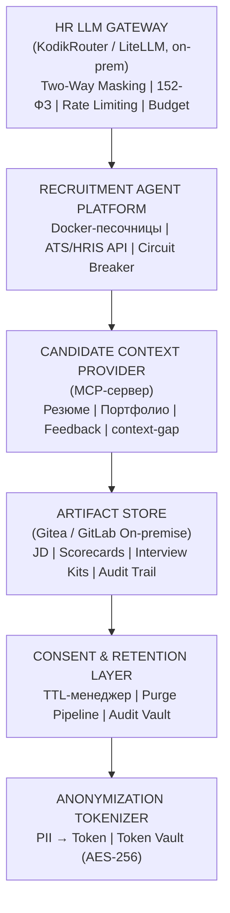
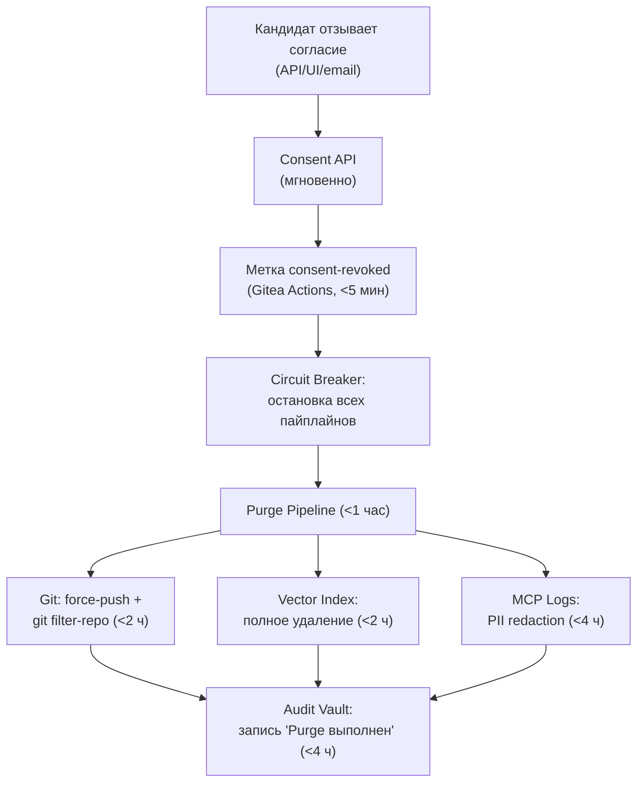
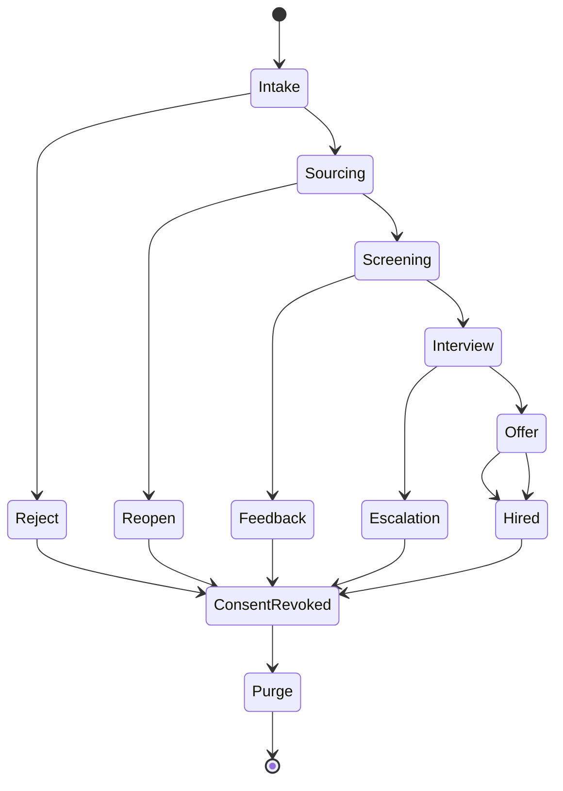

# DESIGN: AI Hiring Blueprint

## Метаданные
- ID: DES-2026-001
- Версия: 1.0
- Статус: Approved
- Связан с: SPEC-2026-001

## 1. Компонентная архитектура

### 1.1. Слои (сверху вниз)

### 1.2. Latency-классы агентов

| Параметр | Фоновый | Интерактивный |
|---|---|---|
| Задачи | Скрининг, ранжирование, JD | Чат-бот, FAQ, scheduling |
| Latency p95 | 15 мин | 5 сек |
| Модель | GigaChat 3.5 Ultra | GigaChat 3 Lightning |
| Бюджет | 1.0 CU / батч | 0.02 CU |
| Max tokens | 200k | 5k |
| Fallback | Ур. 2 → Ур. 3 | Lite → кэш → человек |

Правило: интерактивный агент не может использовать модель фонового.

## 2. Потоки данных

### 2.1. Screening (batch)

```mermaid
flowchart LR
    R["Резюме (PII)"] --> PH["Pre-commit hook<br/>PII-детектор"]
    PH --> GA["Gitea Actions<br/>Semgrep PII, Block"]
    GA --> AT["Anonymization Tokenizer<br/>PII → Token"]
    AT --> LG["LLM Gateway<br/>(работает с токенами)"]
    LG --> GC["GigaChat 3 Lightning<br/>batch 5-10"]
    GC --> SC["Scorecard + риски"]
    SC --> RE["Re-identification<br/>в UI рекрутера (RBAC)"]
    RE --> SR["Self-Check Report"]
```

### 2.2. Consent Revocation (hard trigger)

## 3. Технологический стек

| Слой | Технология |
|---|---|
| LLM (фон) | GigaChat 3.5 Ultra (on-prem, 432B MoE) |
| LLM (интерактив) | GigaChat 3 Lightning (Edge/API) |
| LLM (локальный) | Qwen / DeepSeek через Ollama |
| Gateway | KodikRouter / LiteLLM |
| Artifact Store | Gitea / GitLab On-premise |
| CI/CD | Gitea Actions |
| PII Scan | Semgrep (режим Block) |
| Token Vault | On-prem, AES-256 |
| Vector DB | RAG-индекс (3 мес TTL) |
| MCP | MCP-сервер для Gitea/Forgejo |
| Контейнеризация | Docker (изолированные песочницы) |

## 4. Диаграмма состояний вакансии

## 5. Критерии приемки Design
- [ ] Все FR из SPECS покрыты компонентами.
- [ ] NFR достижимы на выбранном стеке.
- [ ] Согласовано с ИБ (Token Vault, RBAC).
- [ ] Согласовано с MLOps (GPU-кластер, on-prem).
- [ ] Согласовано с DPO (Purge Pipeline).